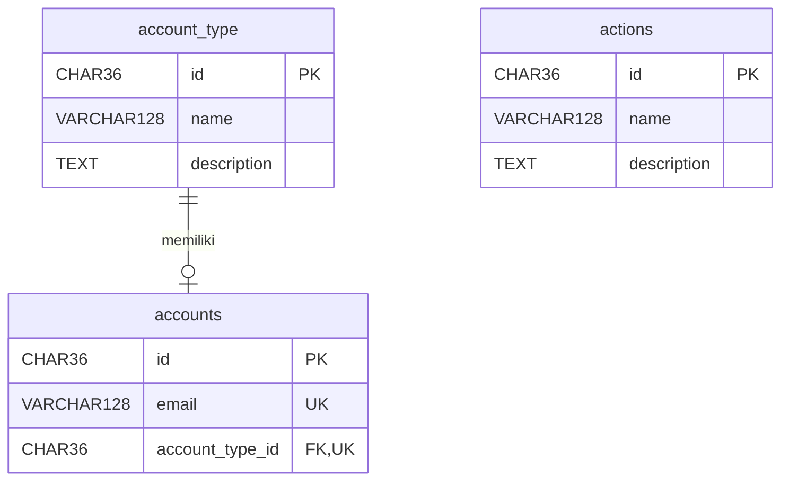

# Dokumentasi Manajemen Akun

Dokumentasi teknis aplikasi UTS Pemrograman Web Lanjut, Program Studi Teknik Informatika, Politeknik Negeri Jakarta, tahun akademik 2026/2027.

## 1. Deskripsi Sistem

### 1.1 Gambaran dan tujuan

Aplikasi Manajemen Akun merupakan aplikasi web untuk menyimpan dan mengelola data akun, tipe akun, serta jenis aksi. Pengguna melakukan login menggunakan email dan password sebelum membuka halaman pengelolaan data.

Tujuan sistem adalah menyediakan pengelolaan data melalui form dan tabel yang terhubung ke database. Pengguna dapat menambahkan data, melihat daftar, mencari data tertentu, mengubah informasi, dan menghapus data dengan soft delete. Dengan soft delete, data yang dihapus tidak muncul lagi pada daftar, tetapi tetap tersimpan sebagai arsip.

Aplikasi dibuat menggunakan PHP native dengan pola Model–View–Controller (MVC). Model menangani query database, view menampilkan halaman HTML, dan controller mengatur input, validasi, serta alur penggunaan. Pemisahan ini memudahkan pemahaman, pemeliharaan, dan modifikasi sistem.

### 1.2 Fitur utama

| Fitur | Fungsi |
| --- | --- |
| Login dan logout | Memeriksa email/password dan menyimpan identitas pengguna melalui session. |
| Pengelolaan akun | Menambah, menampilkan, mencari, mengubah, dan mengarsipkan akun. |
| Pengelolaan tipe akun | Menambah, menampilkan, mencari, mengubah, dan mengarsipkan tipe akun. |
| Pengelolaan jenis aksi | Menambah, menampilkan, mencari, mengubah, dan mengarsipkan nama/deskripsi jenis aksi. |
| Validasi input | Memeriksa data wajib, format, panjang input, email unik, dan pemakaian tipe akun. |
| Relasi akun–tipe | Membatasi satu record tipe untuk maksimal satu akun sesuai ketentuan relasi 1:1. |
| Hash password | Menyimpan hash password dan memeriksanya menggunakan password_verify saat login. |
| UUID dan timestamp | Membuat ID melalui database serta mencatat waktu pembuatan, perubahan, dan penghapusan. |

Data akun meliputi nama, email, password, tipe akun, status Aktif/Nonaktif, jenis identitas NIM/NIP, serta nomor identitas. Tipe akun dan jenis aksi masing-masing mempunyai nama dan deskripsi.

Pada implementasi ini, jenis aksi merupakan data referensi yang dikelola melalui CRUD. Belum ada pemetaan izin dari jenis aksi ke tipe akun, seluruh akun Aktif yang berhasil login dapat membuka ketiga modul.

## 2. Kebutuhan Sistem

### 2.1 Teknologi dan perangkat pendukung

| Komponen | Kebutuhan dan kegunaan |
| --- | --- |
| Server lokal | XAMPP dengan Apache dan layanan MySQL/MariaDB aktif. |
| PHP | PHP native, lingkungan pengujian proyek menggunakan PHP 8.2. Ekstensi PDO dan PDO MySQL diperlukan untuk koneksi database. |
| Database | MySQL atau MariaDB dengan engine InnoDB untuk foreign key dan transaksi. |
| Tampilan | HTML, Bootstrap 5.3.8 lokal, dan JavaScript confirm untuk konfirmasi hapus. |
| Browser | Browser yang mendukung form HTML, CSS, dan JavaScript. |
| Pengelola database | phpMyAdmin untuk import SQL, melihat struktur tabel, dan memeriksa data. |
| Editor | Editor kode untuk membuka dan mengubah file proyek. |

Backend menggunakan PHP native dan PDO. Tampilan memakai Bootstrap 5.3.8 yang disimpan lokal di folder assets/bootstrap, sehingga tidak memerlukan CDN saat aplikasi dibuka. Aplikasi dapat dijalankan secara lokal setelah lingkungan server, database, dan file Bootstrap tersedia.

### 2.2 Database dan konfigurasi

Format penamaan database pada instruksi UTS adalah:

```text
PBL_{JURUSAN}_{ANGKATAN}_{KELAS}_{NAMA}
```

Nama database bawaan adalah **`pbl_ti_2025_b_zahir`**, sesuai nilai pada SQL dan konfigurasi PHP. Nama tersebut memuat jurusan TI, angkatan 2025, kelas B, dan nama Zahir.

| Pengaturan | Nilai pada source |
| --- | --- |
| Host | `127.0.0.1` |
| Port | `3306` |
| Database | `pbl_ti_2025_b_zahir` |
| Username MySQL | `root` |
| Password MySQL | Kosong |
| Character set | `utf8mb4` |
| Collation pada SQL | `utf8mb4_unicode_ci` |
| Zona waktu | Asia/Jakarta pada PHP dan UTC+7 pada koneksi database |

Koneksi dibuat pada [config/database.php](config/database.php) menggunakan PDO. Akun koneksi MySQL berbeda dari akun yang dipakai pengguna untuk login ke aplikasi.

Jika nama database diubah, nilai pada `CREATE DATABASE`, `USE`, `$dbname`, dan nama database aktif harus konsisten, termasuk huruf besar/kecilnya. File [database/schema.sql](database/schema.sql) berisi pembuatan database, tabel, relasi, dan data awal.

### 2.3 Struktur tabel

Nama tabel akun menggunakan **`accounts`**, mengikuti nama pada class diagram.

Kolom yang terdapat pada ketiga tabel:

| Kolom | Tipe data | Keterangan |
| --- | --- | --- |
| `id` | `CHAR(36)` | UUID sebagai primary key yang unik. |
| `created_at` | `DATETIME` | Waktu pembuatan, nilai awal mengikuti CURRENT_TIMESTAMP atau NOW pada INSERT. |
| `updated_at` | `DATETIME` | Waktu perubahan, model memperbaruinya melalui NOW pada UPDATE. |
| `deleted_at` | `DATETIME`, dapat NULL | NULL berarti belum diarsipkan, timestamp berarti sudah diarsipkan. |

**Tabel `accounts`:**

| Kolom tambahan | Tipe data | Keterangan |
| --- | --- | --- |
| `name` | `VARCHAR(128)` | Nama pemilik akun. |
| `email` | `VARCHAR(128)` | Email login dengan batasan UNIQUE. |
| `password` | `TEXT` | Hash password. |
| `account_type_id` | `CHAR(36)` | Foreign key ke account_type.id dan mempunyai batasan UNIQUE. |
| `status` | `VARCHAR(128)` | Pilihan aplikasi Aktif/Nonaktif, nilai awal Aktif. |
| `identification_number` | `VARCHAR(128)` | NIM/NIP sebagai teks agar nol di depan tidak hilang. |
| `identification_type` | `ENUM('NIM', 'NIP')` | Jenis identitas yang diperbolehkan. |

**Tabel `account_type`:**

| Kolom tambahan | Tipe data | Keterangan |
| --- | --- | --- |
| `name` | `VARCHAR(128)` | Nama tipe, misalnya Admin, Dosen, atau Mahasiswa. |
| `description` | `TEXT` | Deskripsi tipe akun. |

**Tabel `actions`:**

| Kolom tambahan | Tipe data | Keterangan |
| --- | --- | --- |
| `name` | `VARCHAR(128)` | Nama jenis aksi. |
| `description` | `TEXT` | Deskripsi jenis aksi. |

Semua tabel memakai InnoDB. ID data baru dibuat menggunakan `UUID()` pada query INSERT. Data awal terdiri dari tipe Admin, Dosen, Mahasiswa, satu akun Administrator, serta aksi Create, Read, Update, dan Delete.

### 2.4 Relasi dan integritas data



Foreign key memastikan `accounts.account_type_id` menunjuk ke record tipe yang ada. UNIQUE pada kolom tersebut memastikan satu tipe digunakan maksimal satu akun. Setiap akun wajib mempunyai satu tipe, sedangkan tipe boleh belum mempunyai akun.

Database memakai ON DELETE RESTRICT dan ON UPDATE RESTRICT untuk relasi ini. Penghapusan melalui aplikasi mengubah timestamp, sehingga record tidak dihapus secara fisik. UNIQUE pada email dan tipe tetap berlaku terhadap akun arsip. Nama tipe tidak UNIQUE, sehingga record tipe yang berbeda boleh mempunyai nama sama.

Tabel actions tidak mempunyai foreign key ke akun atau tipe pada struktur ini.

### 2.5 Struktur proyek

| Lokasi | Tanggung jawab |
| --- | --- |
| [index.php](index.php) | Pintu masuk, pemeriksaan session, routing, dan pemanggilan controller. |
| [config/database.php](config/database.php) | Objek koneksi PDO. |
| [app/Controller.php](app/Controller.php) | Constructor controller, render view, dan halaman data tidak ditemukan. |
| [app/helpers.php](app/helpers.php) | Fungsi h untuk escape HTML dan redirect untuk perpindahan halaman. |
| `app/controllers/` | AuthController, AccountController, AccountTypeController, dan ActionController. |
| `app/models/` | Account, AccountType, dan Action yang berisi SQL. |
| `app/views/` | Halaman login, daftar, form, error, serta layout header/footer. |
| [assets/bootstrap/bootstrap.min.css](assets/bootstrap/bootstrap.min.css) | Tampilan dengan komponen dan grid Bootstrap. |
| [assets/bootstrap/bootstrap.min.js](assets/bootstrap/bootstrap.min.js) | Perilaku buka/tutup navbar pada layar kecil. |
| [database/schema.sql](database/schema.sql) | Struktur tabel, relasi, dan data awal. |

## 3. Proses Pembuatan Fitur

### 3.1 Tahapan implementasi dan MVC

Implementasi mencakup penyusunan skema database berdasarkan class diagram, pembuatan koneksi PDO, pemisahan model/controller/view, pembuatan login dan form CRUD, validasi input, serta pengujian alur data.

Pada setiap permintaan, `index.php` membaca parameter `page` dan `action` dari URL. Nama modul dan fungsi diperiksa terhadap daftar yang diizinkan. Setelah pemeriksaan login, koneksi database dimuat dan `switch` memilih controller. Controller memanggil model, menerima hasil query, lalu mengirim data ke view melalui `render()`.

Controller dasar menyimpan koneksi PDO pada `$this->db`. Method `render()` memakai `extract()` untuk mengubah key data menjadi variabel view, kemudian memuat header, halaman utama, dan footer. Method `notFound()` menampilkan halaman HTTP 404. Helper `h()` digunakan saat mencetak data sebagai HTML, sedangkan `redirect()` mengirim header Location dan menghentikan proses melalui `exit`.

```text
Browser → index.php → Controller → Model → MySQL
                          ↓         ↑ hasil query
                        View → HTML ke browser
```

Contoh route `index.php?page=accounts&action=edit&id=UUID` memilih AccountController dan menjalankan edit untuk ID terkait. Model mengambil data, sedangkan view menampilkan form yang sudah terisi.

### 3.2 Autentikasi login dan logout

Implementasi: [AuthController.php](app/controllers/AuthController.php), [Account.php](app/models/Account.php), dan [view login](app/views/auth/login.php).

Algoritma login:

1. Pada GET, controller menampilkan form login.
2. Pada POST, email dibaca dan dirapikan dengan trim, juga password dibaca tanpa membuang spasi.
3. Model mencari email pada akun yang deleted_at masih NULL.
4. Controller memastikan akun ditemukan dan berstatus Aktif.
5. password_verify mencocokkan password input dengan hash database.
6. Jika cocok, ID session diperbarui dan ID/nama/email disimpan pada session pengguna.
7. Pesan keberhasilan disimpan, lalu browser diarahkan ke daftar akun.
8. Jika gagal, form ditampilkan kembali dengan pesan error dan email sebelumnya.

Pada permintaan berikutnya, akun session diperiksa ulang melalui database. Akun yang diarsipkan atau dinonaktifkan kehilangan akses. Logout dilakukan melalui POST, menghapus identitas pengguna dari session, kemudian mengarahkan browser ke login.

### 3.3 Penambahan data

Controller akun, tipe akun, dan jenis aksi menyediakan create yang memanggil form. Saat belum ada data lama, ID bernilai kosong sehingga form berada pada mode tambah.

Algoritma penambahan:

1. Pengguna membuka form dan mengisi data.
2. Form mengirim POST ke URL yang sedang dibuka.
3. Controller membaca input langsung dari POST dan menyiapkan variabel error.
4. Pemeriksaan dilakukan berurutan dengan if/elseif, serta kesalahan pertama ditampilkan.
5. Jika tidak ada error, controller memanggil method create pada model.
6. Model menjalankan INSERT dengan UUID dan timestamp dari database. Password akun diolah dengan password_hash sebelum menjadi parameter query.
7. Controller menyimpan pesan session dan redirect ke daftar, sehingga refresh halaman daftar tidak mengulang POST terakhir.

Contoh query penambahan akun:

```sql
INSERT INTO accounts
    (id, name, email, password, account_type_id, status,
     identification_number, identification_type, created_at, updated_at)
VALUES
    (UUID(), ?, ?, ?, ?, ?, ?, ?, NOW(), NOW());
```

PDO `prepare()` menyiapkan query dengan placeholder `?`, kemudian `execute()` mengisi nilainya sesuai urutan. `fetch()` mengambil satu baris, `fetchAll()` mengambil semua baris, dan `fetchColumn()` mengambil satu nilai. Kolom `deleted_at` tidak disebut pada INSERT sehingga menggunakan default NULL.

Validasi input yang diterapkan:

| Data | Aturan |
| --- | --- |
| Nama akun/tipe/aksi | Wajib diisi, maksimal 128 byte pada controller. |
| Email akun | Format email valid, maksimal 128 byte, dan tidak dipakai akun lain termasuk arsip. |
| Password akun | Wajib saat tambah dan 6–72 byte, juga saat edit boleh kosong. |
| Tipe akun | Tipe belum diarsipkan dan tidak dipakai akun lain termasuk arsip. |
| Status | Aktif atau Nonaktif. |
| Jenis identitas | NIM atau NIP. |
| Nomor identitas | String digit, panjang 1–128 digit. |
| Deskripsi tipe/aksi | Boleh kosong, maksimal 5000 byte. |

Format email diperiksa dengan filter_var, nomor identitas dengan ctype_digit, dan panjang dengan strlen. Panjang byte pada controller dapat berbeda dari jumlah karakter untuk teks non-ASCII.

### 3.4 Penampilan daftar dan pencarian

Implementasi daftar menggunakan index pada controller, method pembacaan model, dan view index masing-masing modul.

Algoritma daftar/pencarian:

1. Controller mengambil parameter search dari GET dan melakukan trim.
2. Model membentuk kata pencarian menjadi `%kata%` untuk SQL LIKE.
3. Query hanya mengambil record yang deleted_at masih NULL.
4. Daftar akun memakai JOIN dengan account_type agar nama tipe dapat ditampilkan, tipe yang sudah diarsipkan juga tidak disertakan pada JOIN daftar.
5. Hasil query dikembalikan sebagai array melalui fetchAll.
6. View mengulang array dengan foreach untuk mencetak baris tabel dan jumlah hasil. Array kosong menampilkan pesan hasil kosong.

| Modul | Kolom pencarian | Urutan hasil |
| --- | --- | --- |
| Akun | Nama, email, nomor identitas, atau nama tipe. | created_at menurun, lalu nama menaik. |
| Tipe akun | Nama atau deskripsi. | Nama menaik. |
| Jenis aksi | Nama atau deskripsi. | Nama menaik. |

Tanpa kata pencarian, semua data yang memenuhi syarat belum diarsipkan ditampilkan. Akun berstatus Nonaktif tetap terlihat di daftar karena status login dan status arsip merupakan hal berbeda. Tombol Reset membuka daftar tanpa filter pencarian.

### 3.5 Perubahan data

Algoritma perubahan:

1. Link Ubah mengirim ID melalui URL.
2. Controller mencari record yang belum diarsipkan. ID yang tidak tersedia menghasilkan halaman HTTP 404.
3. Form diisi data lama. Keberadaan ID menentukan mode edit.
4. Pada POST, controller melakukan validasi seperti saat tambah. Pengecekan duplikat email/tipe mengecualikan akun yang sedang diedit.
5. Model menjalankan UPDATE dan mengisi updated_at dengan NOW, dan created_at tidak berubah.
6. Controller mengirim pesan berhasil dan redirect ke daftar.

Pada akun, password kosong membuat model melewati query perubahan password, sehingga hash lama tetap dipakai. Password baru yang diisi akan di-hash sebelum diperbarui.

Pilihan tipe menggunakan getAvailableTypes dengan LEFT JOIN. Tipe yang belum dipakai tersedia untuk akun baru, sedangkan tipe milik akun sendiri tetap tersedia ketika mengedit. Akun yang sedang login harus tetap berstatus Aktif.

### 3.6 Penghapusan dengan soft delete

Form Hapus mengirim POST dengan konfirmasi JavaScript confirm. Batal membatalkan submit, sedangkan OK melanjutkan pengiriman.

Algoritma penghapusan:

1. index.php memastikan aksi hapus menggunakan POST.
2. Controller membaca ID dan memeriksa keberadaan data.
3. Untuk akun, penghapusan ditolak jika ID sama dengan akun yang sedang login.
4. Untuk tipe, penghapusan ditolak jika masih dipakai akun yang belum diarsipkan. Akun Nonaktif tetap dihitung jika deleted_at masih NULL.
5. Jika diperbolehkan, model memperbarui deleted_at dan updated_at.
6. Browser diarahkan ke daftar, query daftar menyembunyikan data arsip.

Contoh query penghapusan akun:

```sql
UPDATE accounts
SET deleted_at = NOW(), updated_at = NOW()
WHERE id = ? AND deleted_at IS NULL;
```

Tipe dan aksi menggunakan pola UPDATE yang sama pada tabel masing-masing. Email serta relasi tipe akun arsip tetap terkena batasan UNIQUE. Untuk membuat akun berikutnya, gunakan email baru dan record tipe baru.

### 3.7 Tampilan menggunakan Bootstrap

Halaman menggunakan kelas Bootstrap tanpa CSS khusus buatan proyek. Navbar menyediakan navigasi Akun, Tipe Akun, dan Jenis Aksi. Pada layar kecil, navbar dapat dibuka melalui tombol menu yang dijalankan JavaScript Bootstrap.

Form memakai `form-label`, `form-control`, dan `form-select`. Grid `row` dan `col-md-6` membagi form akun menjadi dua kolom pada layar yang cukup lebar dan satu kolom pada layar kecil. `card` menjadi wadah form/daftar, `table-responsive` memungkinkan tabel digeser horizontal, sedangkan `btn`, `badge`, dan `alert` menampilkan tombol, status, serta pesan.

File CSS dimuat pada layout/header.php dan JavaScript pada layout/footer.php. Class serta komponen mengikuti [dokumentasi Bootstrap](https://getbootstrap.com/docs/5.3/getting-started/introduction/). File lisensi distribusi tersedia pada [assets/bootstrap/LICENSE](assets/bootstrap/LICENSE).

### 3.8 Penanganan input, pesan, dan batas implementasi

Prepared statement PDO memisahkan teks SQL dari nilai input. Helper h memakai htmlspecialchars untuk menampilkan karakter khusus sebagai teks HTML. Hash password digunakan saat penyimpanan, sedangkan password_verify digunakan pada autentikasi.

Pesan hasil simpan/hapus/logout disimpan pada session, ditampilkan oleh header, lalu dihapus agar hanya tampil sekali. Error validasi ditampilkan pada form. Error PDO yang mencapai penangan utama menghasilkan halaman HTTP 500 dengan petunjuk umum, dan detail teknis ditulis ke log PHP.

Routing dibatasi pada modul dan fungsi yang dikenal. Hapus dan logout hanya menerima POST. `.htaccess` menolak akses HTTP langsung ke folder app, config, database, docs, dan tests ketika diterapkan Apache.

Versi yang didokumentasikan digunakan untuk demo lokal UTS, tanpa token CSRF. Belum ada pemetaan hak akses per tipe akun maupun halaman pemulihan arsip.

### 3.9 Sintaks utama

| Sintaks | Fungsi dalam aplikasi |
| --- | --- |
| `$nama`, `$data['name']` | Menyimpan variabel dan mengambil nilai array. |
| `['key' => $value]` | Membentuk pasangan key dan nilai, misalnya data untuk view. |
| `$_GET`, `$_POST`, `$_SESSION` | Membaca parameter URL, isian form, dan identitas/pesan session. |
| `??`, `$kondisi ? $a : $b` | Memberi nilai default atau memilih nilai berdasarkan kondisi. |
| `=`, `===`, `!==` | Memberi nilai serta membandingkan nilai dan tipe. |
| `&&`, `\|\|`, `!` | Menggabungkan atau membalik kondisi pemeriksaan. |
| `.` | Menggabungkan teks, misalnya URL redirect. |
| `if`, `elseif`, `else`, `switch` | Menentukan cabang validasi dan routing. |
| `foreach` | Menampilkan setiap record sebagai baris tabel. |
| `function`, `return` | Mendefinisikan fungsi dan mengembalikan hasil. |
| `class`, `new`, `extends` | Mendefinisikan objek, membuat instance, dan mewarisi controller dasar. |
| `public`, `protected`, `private` | Mengatur akses method dan property. |
| `__construct`, `$this->db`, `$model->getAccounts()` | Membuat objek serta mengakses property dan method. |
| `require`, `__DIR__` | Memuat file berdasarkan direktori file yang sedang dijalankan. |
| `trim`, `strlen`, `filter_var`, `ctype_digit` | Merapikan input, menghitung byte, memeriksa email, dan memeriksa digit. |
| `isset`, `empty`, `unset` | Memeriksa keberadaan/kekosongan nilai dan menghapus key session. |
| `try`, `catch`, `exit` | Menangani error dan menghentikan proses. |
| `<?= h($value) ?>` | Mencetak nilai yang sudah di-escape pada view. |

Query SQL menggunakan `SELECT` untuk membaca, `INSERT` untuk menambah, dan `UPDATE` untuk mengubah atau mengarsipkan. `WHERE` membatasi record, `LIKE` dengan `%kata%` melakukan pencarian, `JOIN` menghubungkan akun dengan tipe, dan `ORDER BY` mengatur urutan. `UUID()` membuat ID, sedangkan `NOW()` mengisi timestamp.

## 4. Demo Aplikasi

### 4.1 Halaman aplikasi

Aplikasi dapat dicoba melalui `http://localhost/uts-pwl/` setelah instalasi. Login awal menggunakan `admin@pnj.ac.id` dengan password `admin123`, selama data awal belum diubah.

| Halaman | Penggunaan |
| --- | --- |
| Login | Mengisi email dan password untuk membuka pengelolaan data. |
| Akun | Melihat dan mencari akun, menambahkan data, mengubah profil/password, serta mengarsipkan akun. |
| Tipe Akun | Mengelola nama/deskripsi tipe serta memeriksa apakah tipe masih dipakai akun. |
| Jenis Aksi | Mengelola nama/deskripsi jenis operasi seperti Create, Read, Update, dan Delete. |
| Logout | Mengakhiri session pengguna dan kembali ke halaman login. |

Hasil soft delete dapat dilihat melalui phpMyAdmin: record tetap tersimpan dengan `deleted_at` terisi, sementara daftar aplikasi hanya menampilkan record yang belum diarsipkan. Password tersimpan sebagai hash, dan nomor identitas mempertahankan nol di depan.

Rekaman video demo belum dicantumkan dalam repository.

### 4.2 Kesesuaian kebutuhan fungsional

| Ketentuan halaman 2 instruksi UTS | Implementasi |
| --- | --- |
| Login dengan email dan password | `AuthController::login()` dan form login. |
| Form penambahan akun | `AccountController::create()` dan form akun. |
| Perubahan dan penghapusan akun | `AccountController::edit()` / `delete()`. |
| Daftar akun | `AccountController::index()` dan view daftar akun. |
| Form penambahan tipe akun | `AccountTypeController::create()` dan form tipe. |
| Perubahan dan penghapusan tipe akun | `AccountTypeController::edit()` / `delete()`. |
| Daftar tipe akun | `AccountTypeController::index()` dan view daftar tipe. |
| Form penambahan tipe aksi atau akses | `ActionController::create()` dan form jenis aksi. |
| Perubahan dan penghapusan tipe aksi atau akses | `ActionController::edit()` / `delete()`. |
| Daftar tipe aksi atau akses | `ActionController::index()` dan view daftar jenis aksi. |

Pencarian tersedia pada ketiga modul. Skema database menerapkan UUID sebagai primary key, relasi akun–tipe 1:1, serta kolom `created_at`, `updated_at`, dan `deleted_at` pada setiap tabel.

Pada instruksi UTS, tabel `actions` tidak mempunyai relasi ke akun atau tipe akun, dan kebutuhan tertulis meminta pengelolaan datanya. Implementasi mengikuti struktur tersebut, jenis aksi dikelola melalui CRUD dan belum menjadi pemetaan izin pengguna.